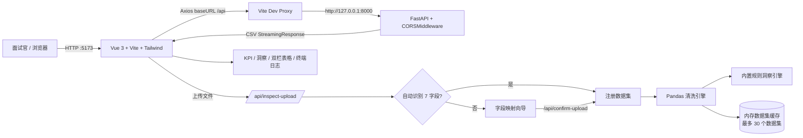

# SmartClean AI · 智能游戏数据清洗与分析看板

> 面向**海外休闲游戏运营**场景的全栈数据清洗 Demo。
> 一键生成 20 条真实感脏数据 → Pandas 智能清洗 → 规则引擎 AI 业务洞察 → 双栏对比 → 导出干净 CSV。

**技术栈**：Python · FastAPI · Pandas · OpenPyXL · Uvicorn / Vue 3 `<script setup>` · Vite · Tailwind CSS · Axios · Lucide Icons

---

## ✨ 核心亮点

- **双模式数据输入**：一键演示脏数据（巴西 / 印尼 / 越南 / 美国等国家，每次随机注入 2~5 条重复行），或拖拽上传真实 `.csv` / `.xlsx`。
- **智能字段映射向导**：上传后自动识别表头；缺字段时弹窗把任意源列映射到 7 个标准字段，支持源数据预览与默认值兜底。
- **Pandas 智能清洗**：缺失值中位数 / Unknown 填充（国家占位为 UNKNOWN）、完全去重、文本标准化、越界异常修正、混合日期统一。
- **本地 AI 规则引擎**：无需外部 API Key、断网可用，始终返回 3 条中文业务诊断与运营建议。
- **SaaS 级看板 UI**：4 个 KPI 卡片、健康度进度条、单元格级红 / 绿角标、终端风格清洗日志流。
- **工程兜底**：Loading 骨架屏、友好错误弹窗、后端离线引导、拖拽遮罩、CSV 导出 BOM 兼容 Excel。
- **国内网络友好**：Python 依赖走清华源，npm 依赖走淘宝源；Vite 代理 + 后端 CORS 双保险，杜绝跨域。

---

## 📁 项目结构

```text
SmartClean_Demo/
├─ backend/                        # FastAPI 后端
│  ├─ venv/                        # 独立虚拟环境（已 gitignore）
│  ├─ app/
│  │  ├─ main.py                   # API 入口 / CORS / 内存数据集缓存 / 上传解析 / 导出
│  │  ├─ mock_data.py              # 20 条海外休闲游戏脏数据生成器（随机 2~5 条重复）
│  │  ├─ cleaner.py                # Pandas 清洗引擎 + 数据体检 + 健康度评分
│  │  └─ insights.py               # 内置规则引擎「AI 洞察」
│  ├─ tests/
│  │  └─ test_idempotency.py       # 清洗幂等性回归测试（含 CSV 导出再导入）
│  └─ requirements.txt
├─ frontend/                       # Vue 3 前端
│  ├─ src/
│  │  ├─ App.vue                   # 状态编排（唯一数据源）
│  │  ├─ api.js                    # Axios 封装 + 统一错误兜底
│  │  ├─ constants.js              # 字段元数据 / 单元格格式化
│  │  ├─ style.css                 # Tailwind 与全局样式
│  │  └─ components/
│  │     ├─ TopBar.vue             # 顶部操作栏 + 后端状态
│  │     ├─ MetricCards.vue        # 4 个核心指标卡片
│  │     ├─ InsightPanel.vue       # AI 业务诊断洞察
│  │     ├─ DataTable.vue          # 原始 / 清洗后复用对比表格
│  │     ├─ ColumnMappingModal.vue # 字段映射向导（源列 → 7 个标准字段）
│  │     └─ TerminalLog.vue        # 终端风格清洗日志流
│  ├─ vite.config.js               # /api → 127.0.0.1:8000 代理
│  ├─ tailwind.config.js
│  └─ package.json
├─ sample_data/
│  ├─ messy_players.csv            # 标准表头的真实感脏数据样本
│  ├─ alias_headers_example.csv    # 表头不同、可全自动映射的示例
│  └─ mapping_demo.csv             # 缺字段、需要人工映射的示例
├─ start_backend.bat               # 双击启动 FastAPI（首次自动建 venv + 清华源装依赖）
├─ start_frontend.bat              # 双击启动 Vite（首次自动淘宝源装依赖）
├─ .gitignore
└─ README.md
```

---

## 🚀 快速开始

### 方式一：双击一键启动（推荐面试现场使用）

1. 双击根目录的 **`start_backend.bat`**
   - 首次运行会在 `backend/` 内自动创建 `venv`，并使用清华源安装依赖。
   - 看到 `Uvicorn running on http://127.0.0.1:8000` 即启动成功。
2. 双击根目录的 **`start_frontend.bat`**
   - 首次运行会使用淘宝源执行 `npm install`。
   - 看到 `Local: http://127.0.0.1:5173/` 即启动成功。
3. 浏览器打开 **<http://127.0.0.1:5173>**（页面会自动载入演示脏数据）。

> 两个窗口都需要保持运行；关闭窗口即停止服务。

### 方式二：手动启动

**后端（Windows PowerShell）**

```powershell
cd backend
py -m venv venv                                  # 或 python -m venv venv
.\venv\Scripts\Activate.ps1
python -m pip install -r requirements.txt -i https://pypi.tuna.tsinghua.edu.cn/simple
python -m uvicorn app.main:app --host 127.0.0.1 --port 8000 --reload
```

**前端**

```powershell
cd frontend
npm install --registry=https://registry.npmmirror.com
npm run dev
```

打开 <http://127.0.0.1:5173>。后端接口文档：<http://127.0.0.1:8000/docs>。

### 30 秒演示动线

1. 页面加载后自动生成 **20 条运营日志**，左侧表格出现红色角标（缺失 / 重复 / 负数金额 / 超长在线时长 / 日期格式混乱）。
2. 点击顶部 **「一键执行 AI 清洗」** → KPI、AI 洞察、右侧绿色修复角标、终端日志同时刷新。
3. 点击 **「导出干净 CSV」** → 下载带 UTF-8 BOM 的结果文件，Excel 打开中文无乱码。
4. 点击 **「上传本地 CSV / Excel」**，选择 `sample_data/alias_headers_example.csv`（表头不同但可自动识别），验证自动映射导入。
5. 再上传 `sample_data/mapping_demo.csv` → 弹出字段映射向导，把 `market` / `progression` / `active_minutes` 分别映射到国家 / 等级 / 在线时长，确认后完成导入与清洗。

---

## 🏗️ 架构图



**数据流**

```text
生成演示数据
        ↓
FastAPI 解析 → 数据体检 profile_raw() → 返回原始行 + 单元格级 flags
        ↓
上传文件 → inspect-upload（源列 / 样例 / 自动映射建议）
        ├─ 7 个字段全部识别 → confirm-upload 直接导入
        └─ 存在缺失字段 → 字段映射向导（可预览、可默认值）→ confirm-upload
        ↓
点击清洗 → clean_dataframe()
        ↓
修复统计 + 健康度 + 分步耗时日志 + 修复单元格 flags
        ↓
insights.build_insights() → 3 条中文业务洞察
        ↓
Vue App.vue 统一持有状态 → props 下发 6 个子组件
        ↓
导出接口读取内存中的 cleaned_dataframe → CSV
```

---

## 🧩 组件通信设计

`App.vue` 是**唯一数据源（single source of truth）**，所有 API 调用与状态变更都在这里完成；子组件保持无副作用、可复用。

| 组件 | 输入（props） | 输出（emit） | 职责 |
| --- | --- | --- | --- |
| `TopBar.vue` | `hasData` / `hasCleaned` / `backendStatus` / `loading` | `load-mock` / `upload-file` / `clean` / `export` / `retry` | 操作入口、文件选择、后端连接状态 |
| `MetricCards.vue` | `metrics` / `preview` / `loading` | — | 纯展示 4 个 KPI 与健康度进度条 |
| `InsightPanel.vue` | `insights` / `loading` | — | 纯展示规则引擎诊断与建议 |
| `DataTable.vue` | `variant` / `columns` / `rows` / `flags` / `loading` | — | 原始、清洗后双场景复用；flags 映射为单元格角标 |
| `ColumnMappingModal.vue` | `open` / `inspection` / `confirming` | `confirm(mapping)` / `cancel` | 字段映射向导：源列下拉、样例预览、重复映射拦截、默认值提示 |
| `TerminalLog.vue` | `logs` / `running` | — | 日志流、自动滚动、复制日志 |

> `DataTable.vue` 通过 `flags`（后端返回的 `{row, field, type, hint}`）建立 `row:field → flag` 映射；原始模式渲染红色 `!`，清洗模式渲染绿色 `✓`，悬停角标显示修复原因。

---

## 🔌 接口说明

Base URL：`http://127.0.0.1:8000`；前端统一通过 Vite 代理访问 `/api`。

| 方法 | 路径 | 用途 |
| --- | --- | --- |
| `GET` | `/api/health` | 健康检查，前端启动时探测后端是否在线 |
| `POST` | `/api/generate-mock-data` | 生成 20 条演示脏数据（随机注入 2~5 条重复行）并写入内存缓存 |
| `POST` | `/api/upload` | 兼容旧接口：`multipart/form-data` 上传并自动按别名导入，缺字段直接返回 400 |
| `POST` | `/api/inspect-upload` | 上传预检：返回 `pending_id`、源列、样例、自动映射建议、缺失字段 |
| `POST` | `/api/confirm-upload` | 按人工确认的 `mapping` 导入数据，源列可任意指定，缺失字段可显式使用默认值 |
| `POST` | `/api/clean-data` | 对指定 `dataset_id` 执行 Pandas 清洗 + 规则洞察 |
| `GET` | `/api/export/{dataset_id}` | 下载清洗后 CSV（UTF-8 BOM，Excel 中文兼容） |
| `GET` | `/docs` | FastAPI 自动生成的 Swagger 文档 |

### 1) 生成演示数据

```http
POST /api/generate-mock-data
```

```json
{
  "dataset_id": "bd92639d4131",
  "source": "mock",
  "filename": null,
  "columns": ["player_id", "country", "device_os", "level_reached", "iap_amount", "session_duration", "last_login"],
  "raw": {
    "rows": [ { "player_id": "PLY-63958", "country": "VN", "device_os": "iOS", "level_reached": 13.0, "iap_amount": -19.9, "session_duration": 70.0, "last_login": "invalid-date" } ],
    "flags": [
      { "row": 0, "field": "iap_amount", "type": "anomaly", "hint": "内购金额为负数（疑似退款符号录入错误）" }
    ],
    "duplicate_rows": [3, 9, 16],
    "total": 20,
    "issue_cells": 50,
    "health": 64.3
  },
  "logs": [ { "step": "演示数据", "message": "已生成 20 条海外休闲游戏运营日志（含缺失 / 重复 / 异常值）", "ms": 3.1, "level": "success" } ]
}
```

> 每次调用会随机注入 **2~5 条完全重复行**：原始总数固定为 20，清洗后有效记录为 **15~18 条**。
> 上例展示的是抽到 3 条重复时的一次运行结果；重复位置、修复数量与洞察指标每次都会略有变化。

### 2) 上传真实文件（字段映射流程）

前端上传采用两阶段接口：

```text
POST /api/inspect-upload  (multipart)
        ↓ 返回 pending_id + 源列 + 样例 + 自动映射建议 + 缺失字段
  7 个字段全部自动识别？
     ├─ 是 → POST /api/confirm-upload（直接导入）
     └─ 否 → 前端弹出字段映射向导 → 用户映射后 POST /api/confirm-upload
```

预检示例：

```powershell
curl.exe -X POST -F "file=@sample_data/mapping_demo.csv" http://127.0.0.1:8000/api/inspect-upload
```

返回结构（节选）：

```json
{
  "pending_id": "d3f2a1c9b7e4",
  "filename": "mapping_demo.csv",
  "total_rows": 6,
  "source_columns": [
    { "name": "account_id", "dtype": "object", "sample": ["PLY-7001", "PLY-7002"] }
  ],
  "sample_rows": [
    { "account_id": "PLY-7001", "market": " br", "app_platform": "iOS" }
  ],
  "suggested_mapping": {
    "player_id": "account_id",
    "country": null,
    "device_os": "app_platform",
    "level_reached": null,
    "iap_amount": "purchase_value",
    "session_duration": null,
    "last_login": "last_seen_at"
  },
  "missing_fields": ["country", "level_reached", "session_duration"],
  "auto_mapped_count": 4
}
```

人工补齐映射后确认导入（`__default__` 表示显式使用默认值）：

```json
POST /api/confirm-upload
{
  "pending_id": "d3f2a1c9b7e4",
  "mapping": {
    "player_id": "account_id",
    "country": "market",
    "device_os": "app_platform",
    "level_reached": "progression",
    "iap_amount": "purchase_value",
    "session_duration": "active_minutes",
    "last_login": "last_seen_at"
  }
}
```

- 映射预检会话保留 **30 分钟**，最多缓存 12 个待确认文件；确认成功后立即失效。
- 同一源列不能重复映射到多个标准字段，前端会禁用已被占用的源列。
- 缺失字段必须选择源列或显式使用默认值；使用默认值会在终端日志和页面标签中明确标记，避免“悄悄伪造数据”。
- 直接调用旧 `/api/upload` 仍可用，但表头缺字段时会返回 400，适合脚本自动化。
- 单文件上限 **10MB**；CSV 按 `utf-8-sig → utf-8 → gb18030 → latin-1` 顺序尝试解码，并自动识别逗号 / 分号 / 制表符。

#### 自定义表头适配

上传文件不要求表头与演示数据完全一致，系统会依次执行：

1. 大小写 / 空格 / 下划线 / 驼峰标准化（`Player ID`、`PlayerID`、`player_id` 均可识别）
2. 常见中英文别名映射
3. 关键词模糊兜底（如 `AverageSessionDuration` → `session_duration`、`TotalRevenue` → `iap_amount`）
4. 仍存在缺失字段时，前端弹出 **字段映射向导**：展示源列、类型、前 5 行样例，用户可把任意源列映射到 7 个标准字段
5. 确认后才注册数据集，额外列自动忽略

字段映射向导还支持：

- 同一源列不能重复映射，已占用的源列会自动禁用
- 默认值兜底（`__default__`），用于完全缺少某维度的情况；会明确标记并写入日志
- 取消映射不会导入数据；预检会话 30 分钟后自动过期
- 全部 7 个字段都能自动识别时，**跳过弹窗直接导入**，不打断演示节奏

| 标准字段 | 常见可用表头（节选） |
| --- | --- |
| `player_id` | `player_id` / `playerid` / `user_id` / `uid` / `account_id` / `玩家id` |
| `country` | `country` / `country_code` / `region` / `nation` / `国家` |
| `device_os` | `device_os` / `os` / `platform` / `operating_system` / `device_type` / `操作系统` |
| `level_reached` | `level_reached` / `level` / `player_level` / `current_level` / `等级` |
| `iap_amount` | `iap_amount` / `iap` / `revenue` / `amount` / `total_spent` / `purchase_amount` / `内购金额` |
| `session_duration` | `session_duration` / `session_length` / `play_time` / `online_time` / `在线时长` |
| `last_login` | `last_login` / `login_time` / `last_active` / `last_seen` / `登录时间` |

可直接上传两个示例验证：

- `sample_data/alias_headers_example.csv`：表头完全不同，但 **7 个字段可全自动识别**，直接导入。
- `sample_data/mapping_demo.csv`：只有 **4/7** 可自动识别，会弹出字段映射向导；可补齐 `market → country`、`progression → level_reached`、`active_minutes → session_duration`。

> 注意：字段映射向导解决的是**结构问题**，不解决业务语义。如果数据集是游戏销量排行、赛事结果等，即使强行映射 + 默认值能跑通，AI 洞察也会失真；此时建议只用于验证上传 / 清洗 / 导出链路。
> 为了让浏览器渲染流畅，建议自定义文件控制在数千行以内；导出与清洗本身不受 20 条演示数据限制。

### 3) 执行 AI 清洗

```http
POST /api/clean-data
Content-Type: application/json

{ "dataset_id": "bd92639d4131" }
```

响应关键字段：

```json
{
  "dataset_id": "bd92639d4131",
  "total": 17,
  "rows": [ { "player_id": "PLY-52520", "country": "PH", "device_os": "Android", "level_reached": 12, "iap_amount": 19.9, "session_duration": 67, "last_login": "2024-03-06 00:00" } ],
  "flags": [ { "row": 0, "field": "country", "type": "repaired", "category": "format", "hint": "国家代码已统一为大写并去除空格" } ],
  "metrics": {
    "raw_total": 20,
    "clean_total": 17,
    "duplicate_removed": 3,
    "missing_filled": 6,
    "anomalies_fixed": 7,
    "format_normalized": 11,
    "repaired_count": 27,
    "raw_issue_cells": 50,
    "remaining_issue_cells": 0,
    "raw_health": 64.3,
    "clean_health": 100.0,
    "health_delta": 35.7,
    "duration_ms": 10.1
  },
  "insights": [
    {
      "id": "quality",
      "level": "critical",
      "title": "数据质量诊断",
      "finding": "本次共处理 27 处数据问题：缺失填充 6 处、异常修正 7 处、格式标准化 11 处……",
      "suggestion": "建议在数据接入层增加字段级校验……",
      "metric": { "label": "累计修复", "value": "27 处" }
    }
  ],
  "logs": [ { "step": "文本标准化", "message": "扫描玩家 ID / 国家 / 设备字段，修复 13 处空格或大小写问题", "ms": 1.2, "level": "success" } ]
}
```

`flags` 的 `row` 是**清洗后行号**（已按去重后的顺序重映射），`field` 为 `null` 时表示整行级问题（去重前的重复行）。

### 4) 导出干净 CSV

```http
GET /api/export/{dataset_id}
```

需先执行过清洗，否则返回 `400 {"detail":"请先执行 AI 清洗，再导出干净 CSV"}`。
响应头包含 `Content-Disposition: attachment; filename="smartclean_cleaned_YYYYMMDD_HHMMSS.csv"`。

---

## 🧼 清洗规则明细

| 字段 | 规则 |
| --- | --- |
| `player_id` | 字符串去首尾空格；缺失填 `Unknown` |
| `country` | 去首尾空格并强制大写（` br ` → `BR`）；缺失填 `UNKNOWN`（与代码统一大写规则一致，保证重复清洗不变化） |
| `device_os` | 统一命名（`ios` → `iOS`，`android` → `Android`）；缺失填 `Unknown` |
| `level_reached` | 转数值；`< 1` 或 `> 100` 视为越界，用合理中位数修正；缺失按中位数填充；最终取整 |
| `iap_amount` | 转数值（支持 `$4.99`、`1,299`、`(12.5)` 等格式）；负数取绝对值（疑似退款符号错误）；`> 499.99` 按中位数修正；保留 2 位小数 |
| `session_duration` | 转数值；`<= 0` 或 `> 720` 分钟视为异常，按合理中位数修正；缺失按中位数填充；最终取整 |
| `last_login` | 兼容 `2024/03/06`、`07/03/2024 09:15`、ISO、非法日期等；统一为 `YYYY-MM-DD HH:MM`；无法解析或缺失按众数日期填充 |
| 重复数据 | `drop_duplicates(keep="first")` 移除完全重复行 |
| 中位数基准 | 仅使用**业务合理区间内**的值计算，避免异常值污染填充结果 |

清洗后会再次执行数据体检，确保 `remaining_issue_cells` 归零，健康度复评为 100。

### 重复清洗幂等性

清洗后的结果可以直接再次清洗，第二次执行不会产生任何新增修复：

```text
第一次：NaN → UNKNOWN
导出 CSV → UNKNOWN
再次清洗 → UNKNOWN（repaired_count = 0）
```

- 国家缺失占位统一为 `UNKNOWN`，与「国家代码全部大写」规则一致；
- `player_id` / `device_os` 缺失仍使用 `Unknown`；
- 数值、日期、去重结果在二次清洗时保持不变。

回归测试：

```powershell
cd backend
.\venv\Scripts\python.exe -m unittest discover -s tests -v
```

覆盖 3 个用例：国家占位大写、二次清洗零修复、CSV 导出再导入后结果稳定。

### 健康度算法

```text
数据健康度 = max(0, 100 - 问题单元格数 / (记录数 × 7) × 100)
```

- 缺失 / 异常 / 格式问题按单元格计数；
- 完全重复行按 `重复行数 × 7` 计为问题单元格；
- 前端展示清洗前健康度、清洗后健康度及相对提升百分比（`health_delta / raw_health × 100%`）。

### AI 洞察选取逻辑（本地规则引擎）

1. **数据质量诊断**：当存在修复项时优先输出，汇总缺失、异常、格式、重复与剩余问题。
2. **核心市场流水洞察**：按 `country` 聚合玩家数 / 流水 / 人均在线，识别 Top 市场集中度。
3. **付费结构与鲸鱼玩家**：计算付费率、ARPPU、Top 20% 玩家流水贡献，判断鲸鱼依赖度。
4. **平台体验与新手引导**：对比 `device_os` 平均在线时长，识别低等级长在线（疑似卡关）玩家。

从中选取 3 条返回；若数据本身干净（无修复项），则自动用第 4 条补足，保证始终 3 条。

---

## 🔒 安全与工程边界

- **工作区隔离**：所有代码、依赖、脚本、临时文件均只落在项目根目录内。
- **Python 环境隔离**：`backend/venv` 独立虚拟环境，不污染全局 Python。
- **无敏感信息**：不含任何 API Key、Token、本地绝对路径或外部服务地址。
- **无外部 AI 依赖**：洞察由内置规则引擎本地生成，断网也能演示。
- **数据不出本机**：上传文件只在内存中解析与缓存，不落盘；内存缓存最多 30 个数据集，超出自动淘汰。
- **输入防护**：上传文件类型白名单、10MB 上限、表头校验、文件名仅保留 basename。
- **跨域兜底**：Vite `/api` 代理 + FastAPI `CORSMiddleware` 双保险。

---

## ❓ 常见问题

**Q1：页面顶部提示「后端服务未连接」？**
先双击 `start_backend.bat`，确认控制台出现 `Uvicorn running on http://127.0.0.1:8000`，再点击页面上的「重新连接」。

**Q2：端口被占用？**

```powershell
Get-NetTCPConnection -LocalPort 8000,5173 -State Listen | Select-Object LocalPort,OwningProcess
Stop-Process -Id <OwningProcess> -Force
```

**Q3：上传后提示缺少必填字段？**
请确认表头包含 7 个标准字段（或受支持的别名）。示例文件见 `sample_data/messy_players.csv`。

**Q4：CSV 用 Excel 打开中文乱码？**
导出的 CSV 已带 UTF-8 BOM，直接双击打开即可；若使用旧版软件，请用「数据 → 从文本/CSV」并选择 UTF-8。

**Q5：依赖安装慢或失败？**
后端脚本已内置清华源，前端脚本已内置淘宝源。若公司网络有代理，请先配置代理环境变量后重试。

**Q6：重新加载数据后，右侧清洗结果为什么清空了？**
新数据集会重置清洗状态，避免展示上一份数据的指标；重新点击「一键执行 AI 清洗」即可。

**Q7：为什么每次演示数据清洗后的条数不一样？**
演示生成器每次会随机注入 **2~5 条完全重复行**，所以原始总记录固定为 20 条，清洗后会在 **15~18 条**之间变化，重复位置、修复数量和洞察指标也会随之变化，更接近真实运营数据场景。上传真实文件时，清洗条数取决于文件自身的重复行数量。

**Q8：上传后为什么弹出「字段映射」？**
说明文件表头没有全部自动对到 7 个标准字段。按弹窗把源列映射到 7 个目标字段即可；可以预览前 5 行，已占用的源列会禁止重复选择。实在没有对应列时可显式选择「使用默认值」，页面与日志会标记，但相应业务洞察会失真。全部自动识别时不会弹窗。


Made with ❤️ for frontend interview demo · SmartClean AI
